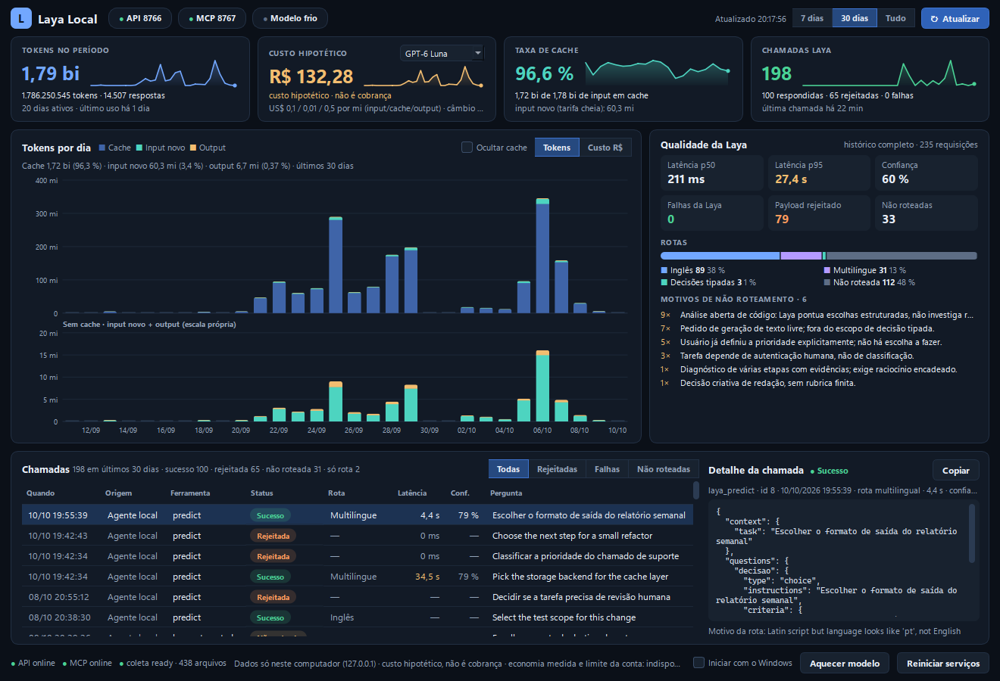
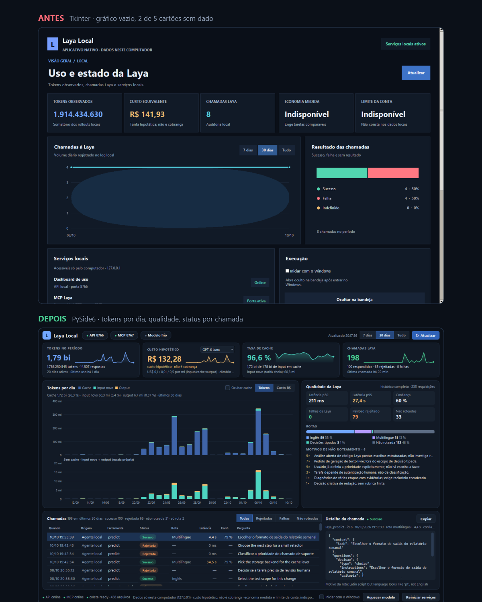
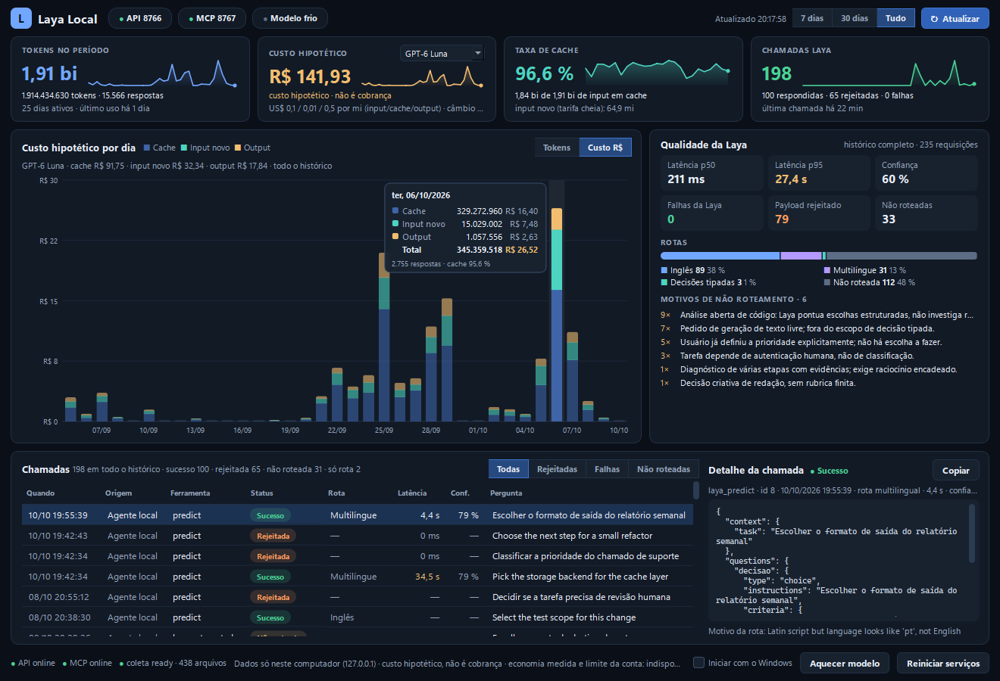

# Laya Local Dashboard

Painel desktop nativo para Windows, escrito em Python (PySide6), que acompanha um servidor
[Laya](https://huggingface.co/convaiinnovations/laya) rodando na própria máquina: quantas decisões
ele respondeu, quanto demorou, onde os agentes erraram o payload, quanta VRAM o modelo ocupa e
quantos tokens os agentes de código consumiram no período.

Tudo fica em `127.0.0.1`. Nada abre no navegador e nada sai do computador.



> As capturas usam `docs/demo_api.json`: números agregados reais, textos de perguntas substituídos
> por exemplos genéricos.

## O que é o Laya

Laya é um motor de decisão *System 1* da Convai Innovations (Apache-2.0): um modelo
não-autoregressivo que responde perguntas **tipadas** em um único *forward pass*, com probabilidades
calibradas, em vez de gerar texto.

| Tipo | Pergunta | Resposta |
|---|---|---|
| `choice` | escolher um entre rótulos finitos | rótulo + probabilidade de cada opção |
| `score` | posicionar numa rubrica ordinal | nível da rubrica |
| `noul` | a condição é verdadeira? | P(verdadeiro) |

Serve para classificar, triar, rotear e pontuar. Não serve para pergunta aberta, resumo, código ou
raciocínio em várias etapas. Aqui ele roda como servidor [MCP](https://modelcontextprotocol.io)
local (Streamable HTTP), e agentes de código o consultam quando têm uma escolha estruturada a fazer —
por exemplo, qual ferramenta usar entre um catálogo fechado (`DECISION_CONTRACT.md`).

### Como funciona por dentro

Um LLM comum é *autoregressivo*: escreve a resposta token por token, e cada token custa uma passada
pela rede. Para decidir entre três opções ele ainda assim "redige" um texto, que depois precisa ser
interpretado. O Laya segue outro caminho:

1. **Entrada.** O estado (texto, e-mail, ticket ou JSON) e as perguntas tipadas são codificados
   juntos. Cada pergunta leva suas instruções e seus critérios — os rótulos de um `choice`, os
   níveis de um `score`.
2. **Uma passada só.** Um *encoder* (família BERT, não um gerador) lê tudo de uma vez. Não há laço
   de geração: várias perguntas sobre o mesmo estado são respondidas na mesma passada.
3. **Saída numérica.** Em vez de texto, sai uma distribuição de probabilidade por pergunta. Um
   `choice` com três opções devolve três números que somam 1; um `noul` devolve P(verdadeiro).
   Não há o que interpretar e não há como "alucinar" uma opção fora da lista.
4. **Probabilidades calibradas.** O treino usa aprendizado por reforço contra regras de pontuação
   estritamente próprias (RLCD), que punem excesso de confiança. A intenção é que 0,8 signifique
   acertar perto de 80% das vezes, o que permite usar a confiança como critério de decisão:
   abaixo de um limiar, o sistema cai num caminho seguro em vez de seguir a sugestão.
5. **Roteamento por idioma.** Um roteador em Python puro detecta escrita e idioma e escolhe o
   checkpoint antes de carregar qualquer coisa na GPU.

| Checkpoint | Encoder | Parâmetros | Uso |
|---|---|---|---|
| `english` | ModernBERT-large | 421 mi | texto em inglês |
| `multilingual` | mmBERT-base | 322 mi | mais de 100 idiomas, incluindo português |
| `typed-decisions` | ModernBERT-large | 421 mi | fluxos específicos de decisão tipada |

Exemplo de pergunta e resposta:

```python
questions = {
    "proximo_passo": {
        "type": "choice",
        "instructions": "Escolha o melhor próximo passo.",
        "criteria": {"inspecionar": "ler os arquivos antes",
                     "editar": "aplicar a mudança agora",
                     "testar": "rodar os testes"},
    }
}
# resposta
{"choice": "editar",
 "probabilities": {"inspecionar": 0.05, "editar": 0.67, "testar": 0.28},
 "answer_confidence": 0.67}
```

Os autores informam 33 ms por pergunta numa GPU T4. Nesta máquina (RTX 5060 Ti) medi 34 a 39 ms por
chamada com três perguntas juntas. O limite da abordagem é o mesmo que a torna rápida: ele escolhe
entre opções que você fornece, não cria opções nem explica o porquê.

Checkpoints usados aqui: `english` e `multilingual`, escolhidos automaticamente pelo idioma do pedido.

## Por que este painel existe

O servidor funcionava, mas era uma caixa-preta. Três perguntas não tinham resposta rápida:

1. **O serviço está de pé?** MCP e API caíam sem aviso e nada os religava.
2. **Os erros são do modelo ou de quem chama?** A taxa de erro aparecia como 33%, o que parecia
   instabilidade.
3. **Quanto isso custa em máquina?** Ninguém sabia quanta VRAM o modelo segurava nem por que a
   primeira chamada do dia levava mais de 30 segundos.

O painel anterior, em Tkinter, não ajudava: o gráfico principal plotava um dado quase inexistente,
dois dos cinco cartões mostravam "Indisponível" para sempre e a tabela não tinha coluna de status.



## O que o painel mostra

- **Cabeçalho em uma linha:** estado da API (8766) e do MCP (8767), estado do modelo
  (quente / frio / aquecendo), filtro global de 7 dias, 30 dias ou tudo.
- **Quatro indicadores com sparkline:** tokens no período, custo hipotético em R$ com seletor de
  modelo, taxa de cache e chamadas ao Laya.
- **Tokens por dia** em barras empilhadas (cache / input novo / output). Como o cache é ~96% do
  volume, um segundo painel repete os dias sem ele, em escala própria — numa escala só, o resto
  desaparece. Alterna para custo diário.
- **Qualidade do Laya:** latência p50 e p95 lado a lado (a média esconde a cauda), confiança média,
  rotas por checkpoint e motivos de não roteamento.
- **Tabela de chamadas** com status colorido, rota, latência e confiança; filtro por rejeitadas,
  falhas e não roteadas; detalhe com o JSON da pergunta.
- **Rodapé:** reiniciar serviços, aquecer/descarregar o modelo, iniciar com o Windows.



O custo é sempre rotulado como **hipotético**: tokens observados multiplicados por uma tabela de
tarifas, não cobrança real. Economia medida e limite de conta não aparecem porque não existem nos
dados locais; o painel não inventa zero para preencher espaço.

## Dificuldades e como foram resolvidas

### 1. Um terço das chamadas "falhava" — e nenhuma era culpa do modelo

Analisando 77 erros registrados: **todos** eram `invalid_questions`, ou seja, payload recusado na
validação antes de chegar ao modelo. Em 90% deles o agente mandava `criteria` de uma pergunta
`choice` como lista, quando o formato exigido é objeto `{rótulo: descrição}`. Escrever a regra na
documentação do agente não bastou; o erro voltou dois dias depois.

A correção foi no servidor (`runtime/laya_mcp_dashboard.py`):

- lista em `choice.criteria` é convertida para objeto antes de validar (e o inverso para `score`);
- a descrição e o schema publicados da ferramenta dizem o formato exato por tipo — o texto original
  dizia `criteria?: object|array`, que é de onde vinha a confusão;
- quando o payload ainda é inválido, o erro volta com `hint` e `valid_examples`;
- o painel separa **payload rejeitado** de **falha do Laya**. Com a separação, a taxa real de falha
  do modelo no histórico é zero.

### 2. Primeira chamada de 35 segundos

Deixar o modelo sempre carregado resolveria, ao custo de VRAM ocupada o dia todo. Medi as três
opções antes de escolher (`tools/bench_loading.py`, RTX 5060 Ti 16 GB):

| | GPU | CPU (12 threads) |
|---|---|---|
| Latência por chamada (`english`) | 39 ms | 719 ms |
| Tempo de CPU por chamada | 39 ms | ~4,2 s |
| VRAM com um checkpoint | 2,7 GB | 0 |
| Recarregar após descarregar | 0,7 s | 0,3 s |
| VRAM residual após descarregar | 0,16 GB | — |

CPU é 18× mais lenta e ocupa vários núcleos por chamada. Preload permanente gasta 2,7 GB para
economizar 0,7 s. O que ficou:

- o modelo **aquece quando um agente conecta** (o handshake MCP acontece antes da primeira pergunta);
- **descarrega após 10 minutos** sem chamadas, ou antes se a VRAM livre apertar;
- **não aquece** se houver menos de 4 GB de VRAM livres (um jogo aberto, por exemplo);
- ao subir, o serviço lê pesos e DLLs para o cache de disco em prioridade de fundo, que é a parte
  lenta da primeira carga depois de ligar o PC.

Resultado medido no serviço real: a pior chamada observada era de 34,5 s (disco frio); hoje uma
chamada com o checkpoint ainda não carregado leva 4,4 s, e menos de 1 s com
o checkpoint já em cache de processo.

### 3. Escolher o toolkit sem sair do Python

Antes de reescrever, o mesmo painel foi prototipado em três toolkits, com os mesmos dados:

| | PySide6 | CustomTkinter | Dear PyGui |
|---|---|---|---|
| Acabamento | antialiasing, tabela e DPI prontos | bom, mas tabela e gráficos à mão | ótimos gráficos, controles com cara de ferramenta |
| Abertura | ~0,5 s | ~1,15 s | 0,35–0,66 s |
| CPU parado | ~0% | ~0% | 3–4,5% (laço de render contínuo) |
| Bandeja do sistema | nativa (`QSystemTrayIcon`) | código Win32 próprio | sem suporte direto |

PySide6 ganhou por resolver bandeja, tabela e alta resolução com peças prontas — a versão Tkinter
carregava ~330 linhas de `ctypes` só para o ícone de bandeja. O custo é um executável maior
(27 MB contra 12 MB). Os gráficos são desenhados com `QPainter`, sem QtCharts nem webview.

### 4. Serviço caindo em silêncio

O painel agora confere as portas a cada atualização e, se MCP ou API sumirem, tenta subir o runtime
de novo (no máximo uma vez por minuto), registrando em `local-services.log`. Há também o botão
"Reiniciar serviços", que só encerra processos Python escutando nas portas do Laya.

## O que aprendi de Python neste projeto

- **Threads e sinais em GUI:** coleta em *worker thread*, entrega por sinal Qt; a interface nunca
  bloqueia esperando rede.
- **Desenhar em vez de importar:** barras empilhadas, sparklines e tooltips em `QPainter` deram
  controle total e mantiveram uma única dependência.
- **Medir antes de otimizar:** o benchmark derrubou duas hipóteses (CPU "boa o bastante" e preload
  permanente) em dez minutos.
- **Corrigir na fronteira:** normalizar a entrada no servidor resolveu o que documentação para o
  cliente não resolvia.
- **Empacotamento:** PyInstaller com exclusões de módulos Qt não usados, e o cuidado de não vazar o
  ambiente do executável para os processos filhos.
- **`sqlite3`, `http.server`, `ctypes`, `subprocess`:** quase tudo aqui é biblioteca padrão.

## Arquitetura

```
agentes de código ──MCP──▶ runtime/laya_mcp_dashboard.py :8767
                                │  normaliza payload, audita chamadas,
                                │  aquece / descarrega o modelo
                                ▼
                          Laya (torch, GPU)
                                │
        SQLite local ◀──────────┤
                                ▼
                   runtime/laya_dashboard.py :8766  (API JSON, só loopback)
                                │
                                ▼
                   prototype/laya_app.py  (PySide6, bandeja do sistema)
```

| Caminho | Conteúdo |
|---|---|
| `prototype/laya_app.py` | o painel (Qt Widgets + QPainter) |
| `prototype/startup.py`, `laya_startup.vbs` | início com o Windows |
| `prototype/native_app.py`, `windows_tray.py` | versão anterior em Tkinter, mantida para comparação |
| `runtime/laya_mcp_dashboard.py` | envoltório do servidor MCP: normalização, auditoria, ciclo de vida do modelo |
| `runtime/laya_dashboard.py` | API local e coleta de uso de tokens |
| `tools/` | benchmark de carga, dados de demonstração, capturas, utilitários de medição |
| `tests/` | testes do runtime e do ciclo de vida do modelo |
| `DECISION_CONTRACT.md` | contrato do seletor de capacidades em modo sombra |

## Rodar

Só para ver o painel, sem Laya instalado:

```powershell
python -m venv .venv
.venv\Scripts\pip install -r requirements.txt
.venv\Scripts\python prototype\laya_app.py --sample
```

Com o runtime: instale o pacote `laya` e as dependências do servidor MCP num ambiente em
`%USERPROFILE%\.codex\laya-runtime\.venv`, copie os arquivos de `runtime/` e `tools/laya_dispatch.py`
para essa pasta e abra o painel sem `--sample`; ele sobe MCP e API sozinho.

Gerar o executável:

```powershell
.\prototype\build.ps1
```

Variáveis do ciclo de vida do modelo: `LAYA_WARM_MODEL` (padrão `english`), `LAYA_WARM_ON_CONNECT`,
`LAYA_IDLE_UNLOAD_S` (600), `LAYA_WARM_MIN_FREE_MB` (4000), `LAYA_PRESSURE_FREE_MB` (1500),
`LAYA_DISK_PREWARM`.

## Privacidade

- API e MCP escutam apenas em `127.0.0.1`.
- A auditoria guarda a pergunta estruturada com redação de e-mails, tokens e chaves, truncada.
- A coleta de uso lê somente contadores de tokens dos registros locais dos agentes; não lê prompts
  nem respostas.

## Limitações conhecidas

- Só Windows.
- O painel de qualidade usa agregados do histórico completo e não segue o filtro de período.
- Pedidos em português usam o checkpoint `multilingual`, que não é pré-aquecido: a primeira chamada
  de cada período ocioso leva ~4 s.
- O ganho do cache de disco após um boot frio ainda não foi medido.
- O protocolo MCP não identifica o agente chamador; a coluna "Origem" mostra só o rótulo disponível.

## Créditos

O modelo e o pacote [`laya`](https://huggingface.co/convaiinnovations/laya) são da Convai Innovations
(Apache-2.0). Este repositório contém apenas o painel, o envoltório do servidor e as ferramentas de
medição.
